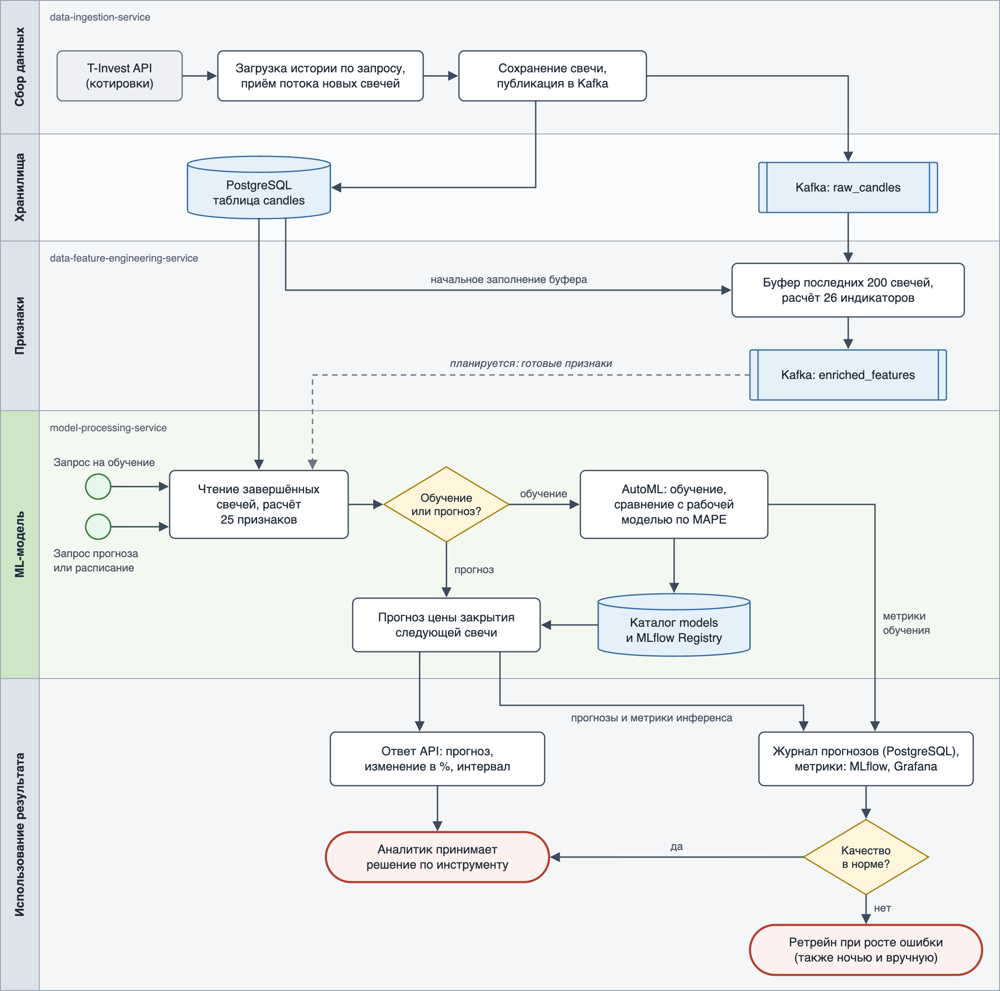

# Место модели в процессе проекта

Проект автоматизирует ML-пайплайн прогнозирования цены акций: от получения котировок до прогноза, которым пользуется аналитик. Модель (AutoGluon TimeSeries, подробности — в [model_card.md](model_card.md)) работает в сервисе `model-processing-service` и стоит между подготовкой данных и принятием решения человеком.

## Схема процесса

Горизонтальные дорожки — этапы процесса и отвечающие за них сервисы; дорожка модели выделена зелёным. Кружки — события запуска, ромбы — развилки, синие блоки — хранилища и топики Kafka, красные — завершающие события. Пунктиром показана связь, которая запланирована, но ещё не реализована.

Редактируемый исходник схемы — [model_bpmn.svg](model_bpmn.svg).

**Текущее состояние.** Сервис модели к Kafka не подключён: топики `raw_candles` и `enriched_features` он не читает, а свечи берёт напрямую из PostgreSQL и рассчитывает признаки сам. Подключить `enriched_features` можно не сразу: сервис признаков считает другой набор индикаторов (26 против 25 у модели, с другими формулами и названиями) и нигде их не хранит. Поэтому для перехода модель нужно переобучить на признаках сервиса и начать сохранять их историю для обучения.

## Какую задачу в процессе решает модель

Модель отвечает на вопрос «какой будет цена закрытия следующей свечи по инструменту» и даёт три величины: точечный прогноз, ожидаемое изменение к последней цене в процентах и интервал прогноза (квантили 0.1 и 0.9).

В процессе она заменяет ручной анализ графика и индикаторов, который аналитик иначе выполнял бы по каждому инструменту и таймфрейму самостоятельно. Для каждой пары «инструмент + таймфрейм» обучается отдельная модель.

## Почему для этой задачи целесообразно использовать ML

- **Много взаимосвязанных сигналов.** Прогноз опирается на десятки индикаторов (скользящие средние, MACD, RSI, полосы Боллинджера, объём, лаговые доходности). Жёсткие правила вида «RSI выше 70 — продавать» не учитывают их совместное влияние, а модель подбирает зависимости по данным.
- **Рынок меняется.** Паттерны устаревают, и правила пришлось бы пересматривать вручную. Модель переобучается на свежей истории автоматически — каждую ночь и при росте фактической ошибки — и заменяется, только если новая версия прогнозирует не хуже текущей.
- **AutoML вместо ручного подбора.** AutoGluon сам обучает статистические, табличные и нейросетевые модели, сравнивает их по MAPE на валидации и собирает ансамбль. Добавление нового инструмента или таймфрейма не требует работы ML-инженера.
- **Оценка неопределённости.** Модель выдаёт не только число, но и интервал прогноза.

## Какие данные поступают на вход модели

| Что | Откуда | Описание |
|---|---|---|
| Свечи OHLCV | PostgreSQL, таблица `candles` | Время, цены открытия, максимума, минимума, закрытия и объём; только завершённые свечи. В таблицу их пишет `data-ingestion-service` из T-Invest API: история по запросу и новые свечи потоком |
| Параметры запроса | REST API сервиса | Идентификатор инструмента, таймфрейм (от `1MIN` до `1MONTH`), для прогноза — глубина истории |
| Признаки | Рассчитываются из свечей | 25 технических индикаторов: геометрия свечи, скользящие средние, MACD, RSI, полосы Боллинджера, объём, доходности за 1, 2, 3 и 5 шагов |
| Обученная модель | Каталог `models`, MLflow Registry | Нужна только для прогноза |

Для обучения берётся вся история инструмента на выбранном таймфрейме (не меньше 100 свечей), для прогноза — последние 60 свечей по запросу или 100 в задаче по расписанию (не меньше 30).

## Как результат работы модели используется дальше

- **Ответ API аналитику.** `POST /api/v1/predict` возвращает прогноз цены, изменение в процентах, интервал и дату прогноза. Аналитик использует его как один из сигналов при решении по инструменту; автоматических сделок система не совершает.
- **Прогнозы по расписанию.** Задача планировщика (cron) делает прогноз без участия человека и записывает его в MLflow — получается история прогнозов по инструменту.
- **Журнал прогнозов.** Каждый прогноз — по API и по расписанию — сохраняется в таблицу PostgreSQL `model_predictions` вместе с отметкой модели, которая его сделала (`model_version` в ответе API). Когда появляется следующая свеча, прогноз сверяется с фактической ценой закрытия, и по последним прогнозам считается фактическая ошибка рабочей модели.
- **Мониторинг.** Прогнозы и результаты обучения уходят в Prometheus и отображаются в Grafana: MAPE лучшей модели и всех кандидатов, фактический MAPE прогнозов рабочей модели (`model_realized_mape`), предсказанная цена, распределение предсказанных изменений, время и ошибки инференса.
- **Обратная связь.** Если фактическая ошибка рабочей модели выше 3 %, сервис сам запускает переобучение. Кроме того, модели переобучаются каждую ночь, если пришли новые свечи, а аналитик может запустить переобучение вручную (`POST /api/v1/retrain`). Новая версия заменяет рабочую, только если на последних 20 свечах её MAPE не хуже. Процесс описан в [Model_retrain_BPMN.md](Model_retrain_BPMN.md).
- **Реестр моделей.** Каждая модель, попавшая в эксплуатацию, регистрируется в MLflow Registry с метриками и параметрами; отклонённые при переобучении версии в реестр не попадают. Каждый запуск обучения фиксируется в таблице `model_training_runs` со статусом `done`, `rejected` или `error` — это позволяет сравнивать версии и разбирать, какой моделью сделан прогноз.
