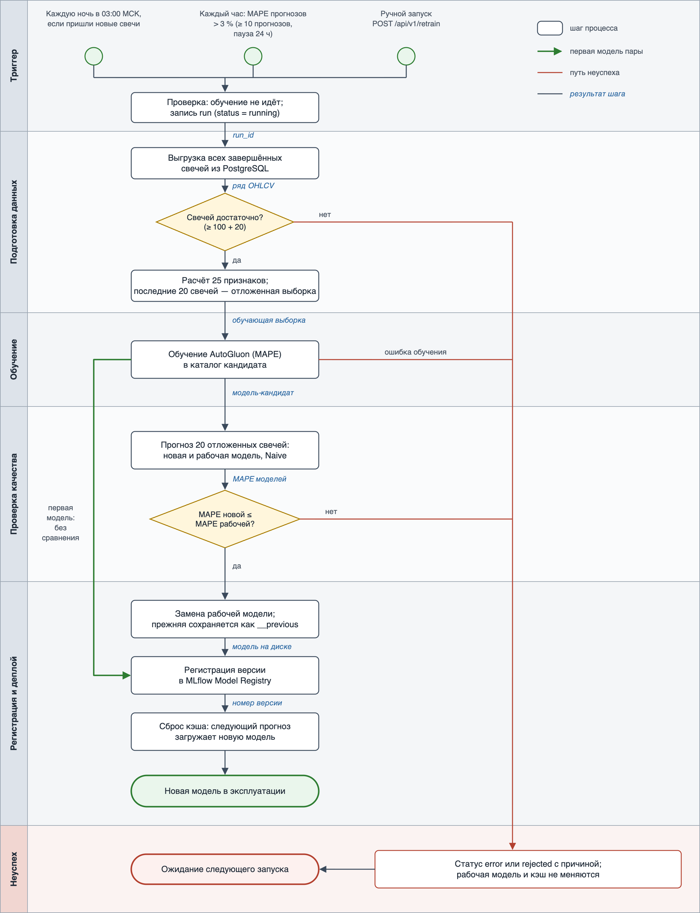

# Процесс переобучения модели

Документ описывает переобучение модели прогноза цены закрытия — от триггера до ввода новой версии в эксплуатацию. Подробности о модели — в [model_card.md](model_card.md), её место в общем процессе — в [Model_BPMN.md](Model_BPMN.md).

Переобучение запускается автоматически: каждую ночь по расписанию и при росте фактической ошибки прогнозов. Его можно запустить и вручную. Новая модель попадает в эксплуатацию, только если на последних свечах она прогнозирует не хуже текущей рабочей модели; иначе рабочая модель остаётся.

Код процесса:

| Модуль | Что делает |
|---|---|
| [app/retrain.py](app/retrain.py) | Триггеры: ночная задача, ежечасная проверка ошибки; запуск переобучения и запись результата в журнал |
| [app/ml/retraining.py](app/ml/retraining.py) | Обучение кандидата, сравнение с рабочей моделью, замена модели, регистрация в MLflow |
| [app/ml/training.py](app/ml/training.py) | Обучение модели AutoGluon |

## Схема процесса

Горизонтальные дорожки — этапы процесса. Зелёная линия — путь первой модели пары, которую не с чем сравнивать. Красные линии — путь неуспеха, синие курсивные подписи — результат, который этап передаёт дальше.

Редактируемый исходник схемы — [model_retrain_bpmn.svg](model_retrain_bpmn.svg).

## Этапы процесса

### 1. Триггер запуска

Переобучение запускается для пары «инструмент + таймфрейм» одним из трёх событий:

| Триггер | Когда срабатывает | Для каких пар |
|---|---|---|
| Ночное расписание | Каждую ночь в 03:00 по Москве, после закрытия вечерней сессии. Пара пропускается, если с её прошлого запуска обучения не пришло ни одной новой завершённой свечи, — например, в выходные | Все пары, у которых есть обученная модель |
| Рост фактической ошибки | Проверка идёт каждый час в :15. Ретрейн запускается, если выполнены все условия: сверено не меньше 10 прогнозов текущей модели; их средний MAPE (по последним 20) выше 3 %; с прошлого запуска обучения прошло больше 24 часов | Все пары, у которых есть обученная модель |
| Ручной запуск | Вызов `POST /api/v1/retrain` с параметрами `instrument_uid`, `interval` и, при необходимости, `time_limit` | Любая пара |

**Как считается фактическая ошибка.** Каждый прогноз — по API и по расписанию — сохраняется в таблицу `model_predictions` вместе с отметкой модели, которая его сделала. Когда появляется следующая завершённая свеча, прогноз сверяется с её ценой закрытия. Учитываются только прогнозы текущей рабочей модели, поэтому после замены модели счёт начинается заново. Фактический MAPE выводится в Prometheus метрикой `model_realized_mape`.

**Зачем пауза 24 часа.** Если новую модель отклонят, рабочая модель и её высокая ошибка останутся, и без паузы ретрейн запускался бы каждый час. Ночной запуск тоже считается, поэтому в будни проверка ошибки срабатывает в основном тогда, когда ночного запуска не было.

Перед стартом сервис проверяет, что пара сейчас не обучается: в журнале нет запуска со статусом `running`, и ни один другой триггер в этот момент её не обучает. Иначе запуск пропускается, а вызов API получает код 409. Затем в таблице `model_training_runs` создаётся запись со статусом `running`.

**Результат:** `run_id` запуска, инструмент, таймфрейм, лимит времени обучения.

### 2. Получение и подготовка данных

Сервис выгружает из PostgreSQL все завершённые свечи пары (`is_complete = TRUE`); если их нет совсем, запуск не создаётся, а API отвечает кодом 404.

Если у пары уже есть рабочая модель, нужно не меньше 120 свечей: 100 для обучения (`MIN_CANDLES_TRAIN`) и 20 последних для сравнения (`RETRAIN_HOLDOUT_SIZE`). Эти 20 свечей в обучение не попадают — это отложенная выборка, на которой новая модель будет сравниваться с рабочей. Из свечей рассчитываются 25 технических признаков: геометрия свечи, скользящие средние, MACD, RSI, полосы Боллинджера, объём, доходности.

**Результат:** обучающая выборка и отложенная выборка из 20 свечей.

### 3. Обучение новой версии

AutoGluon TimeSeries с пресетом `medium_quality` обучает модели-кандидаты в пределах лимита времени (по умолчанию 120 секунд) и собирает из них взвешенный ансамбль. Модель сохраняется в отдельный каталог `models/{instrument_uid}__{interval}__candidate/`, поэтому рабочая модель продолжает обслуживать прогнозы, пока идёт обучение. Обучение идёт в отдельном потоке, и сервис продолжает отвечать на запросы. Параметры, признаки, leaderboard и сама модель записываются в запуск MLflow.

**Первая модель пары.** Если рабочей модели ещё нет, сравнивать не с чем: модель обучается на всех свечах сразу в рабочий каталог и переходит к регистрации (зелёная линия на схеме).

**Результат:** модель-кандидат.

### 4. Проверка качества

Новая модель и рабочая модель прогнозируют каждую из 20 отложенных свечей на один шаг вперёд — каждый раз только по истории до этой свечи. Для обеих считается MAPE. Для справки считается и MAPE наивного прогноза «цена не изменится». Все три значения записываются в запуск MLflow (`holdout_candidate_mape`, `holdout_production_mape`, `holdout_naive_mape`) и возвращаются в ответе API в поле `comparison`.

**Результат:** MAPE новой модели, рабочей модели и наивного прогноза на одних и тех же свечах.

### 5. Решение о публикации

Новая модель публикуется, если её MAPE на отложенной выборке не больше MAPE рабочей модели. Допустимое ухудшение задаётся настройкой `RETRAIN_MAPE_TOLERANCE`; по умолчанию оно равно 0, то есть новая модель должна быть не хуже.

Если новая модель хуже, она удаляется, рабочая модель остаётся, а запуск получает статус `rejected` с причиной. Решение записывается тегом `decision` в запуск MLflow.

**Результат:** решение «публиковать» или «отклонить» с причиной.

### 6. Регистрация и сохранение новой версии

Каталог новой модели становится рабочим `models/{instrument_uid}__{interval}/`. Прежняя модель сохраняется как `models/{instrument_uid}__{interval}__previous/`, и при необходимости к ней можно вернуться вручную. Новая модель регистрируется в MLflow Model Registry как очередная версия модели `Price_Predictor_{instrument_uid}_{interval}`; отклонённые модели в реестр не попадают. Запуск в `model_training_runs` получает статус `done`, лучшую модель, MAPE и leaderboard.

**Результат:** новая модель в рабочем каталоге и номер её версии в реестре.

### 7. Деплой

Новая модель разворачивается внутри работающего сервиса, без пересборки Docker-образа: CI/CD через GitHub Actions доставляет код, а модели лежат в томе `model_data`. После замены сервис удаляет прежнюю модель из кэша в памяти, и следующий прогноз — по API или по расписанию — загружает новую модель с диска. Перезапуск сервиса не нужен.

**Результат:** новая модель обслуживает прогнозы; её фактическая ошибка снова отслеживается с нуля.

## При каких условиях модель попадает в эксплуатацию

1. Сработал один из триггеров: ночное расписание при наличии новых свечей, рост фактической ошибки выше 3 % или ручной вызов.
2. Пара в этот момент не обучается.
3. Свечей хватает для обучения и сравнения: не меньше 120, а для первой модели пары — не меньше 100.
4. Обучение завершилось без ошибок.
5. На последних 20 свечах MAPE новой модели не больше MAPE рабочей. Для первой модели пары этот шаг пропускается.

## Действия при неуспехе

Общее правило: при любом неуспехе рабочая модель и кэш не меняются, прогнозы продолжают идти от прежней модели.

| Где произошёл сбой | Что происходит | Что дальше |
|---|---|---|
| Пара уже обучается | Запуск пропускается; вызов API получает код 409 | Следующее срабатывание триггера |
| Свечей нет | Запуск не создаётся; вызов API получает код 404 | Следующее срабатывание триггера |
| Свечей недостаточно или ошибка обучения | Запуск получает статус `error` с текстом ошибки; каталог кандидата удаляется; вызов API получает код 500 | Следующее срабатывание триггера |
| Новая модель хуже рабочей | Запуск получает статус `rejected` с причиной и значениями MAPE; новая модель удаляется и в реестр MLflow не попадает | Следующая ночь с новыми свечами или проверка ошибки после паузы 24 часа |
| Сбой одной пары в ночной или ежечасной задаче | Ошибка записывается в лог, а если обучение успело начаться — и в журнал запусков; остальные пары обрабатываются дальше | Следующее срабатывание задачи |

## Настройки

Все параметры задаются переменными окружения; значения по умолчанию — в [.env.example](.env.example).

| Переменная | По умолчанию | Смысл |
|---|---|---|
| `RETRAIN_CRON` | `0 3 * * *` | Расписание ночного ретрейна; пустое значение выключает его |
| `RETRAIN_TIMEZONE` | `Europe/Moscow` | Часовой пояс расписаний |
| `RETRAIN_ERROR_CHECK_CRON` | `15 * * * *` | Расписание проверки фактической ошибки; пустое значение выключает её |
| `RETRAIN_MAX_REALIZED_MAPE` | `0.03` | Порог фактической ошибки, 3 % — граница «нормы» на дашборде Grafana |
| `REALIZED_ERROR_WINDOW` | `20` | По скольким последним сверенным прогнозам считается ошибка |
| `REALIZED_ERROR_MIN_POINTS` | `10` | Сколько прогнозов нужно сверить, чтобы проверка могла сработать |
| `RETRAIN_COOLDOWN_HOURS` | `24` | Пауза после любого запуска обучения перед ретрейном из-за ошибки |
| `RETRAIN_HOLDOUT_SIZE` | `20` | Сколько последних свечей откладывается для сравнения моделей |
| `RETRAIN_MAPE_TOLERANCE` | `0.0` | Допустимое ухудшение MAPE новой модели (0.05 = 5 %) |

## Что ещё можно улучшить

- **Проверочный прогноз после замены и автоматический откат**, если новая модель не загрузилась или выдаёт неправдоподобные значения. Сейчас прежняя модель сохраняется в `__previous`, но вернуть её можно только вручную.
- **Проверка свежести данных** перед обучением: сейчас модель обучится и на устаревших свечах, если сбор данных остановился.
- **Прогноз и сверка по событию.** Можно реагировать на новую свечу из топика Kafka `raw_candles` сразу, а не по расписанию.
- **Отметка триггера в журнале запусков:** по таблице `model_training_runs` сейчас не видно, был запуск ночным, по ошибке или ручным; это видно только в логах.
